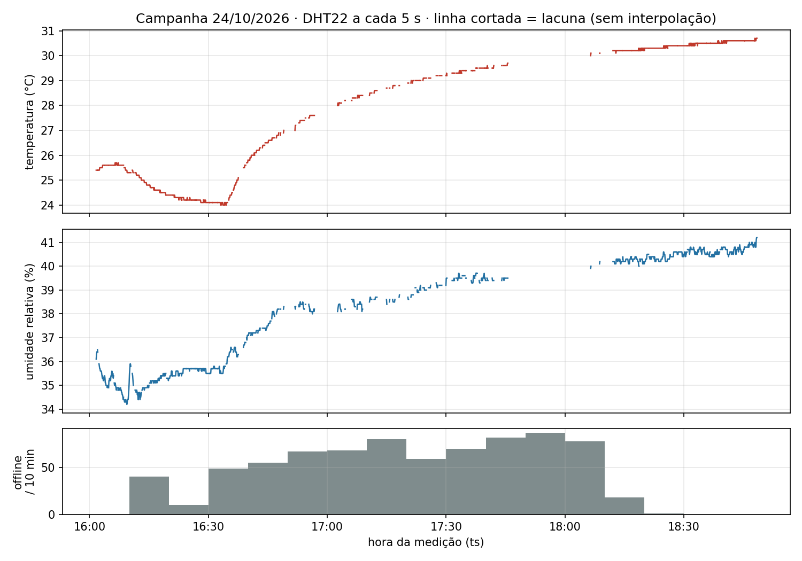

# Campanha de coleta · 24/10/2026, 16:01 a 18:48

Nó `eq01-no02`: ESP32 + DHT22 no GPIO15, publicando a cada 5 s com QoS 1 no broker
público `broker.hivemq.com:8883` (TLS). Firmware em `wokwi/sketch/`, gravado com
PlatformIO. Gravado por `gravador/gravador.py --host broker.hivemq.com --equipe eq01`,
com sessão persistente.

| Arquivo | O que é |
|---|---|
| `mensagens.csv` | CSV bruto do gravador (telemetria e status), sem nenhuma edição |
| `qualidade_saida.txt` | saída completa de `python gravador/qualidade.py dados/campanha_24-10-26/mensagens.csv` |
| `serie_temporal.png` | `python gravador/grafico.py dados/campanha_24-10-26/mensagens.csv -o dados/campanha_24-10-26/serie_temporal.png` |

**Instalação:** o nó ficou em cima de uma escrivaninha, no mesmo cômodo do
ar-condicionado, mas fora do alcance direto do fluxo de ar dele. O sensor mediu o ar do
cômodo, não o ar que sai do aparelho.

## Registro de eventos

| Hora | Evento | Efeito nos dados |
|---|---|---|
| 16:01:36 | nó reiniciado (início da campanha) | `seq` volta a 1 |
| 16:10:14 | gravador ligado | lote de 100 leituras guardadas pelo broker (Seção 2) |
| **16:35** | **ar-condicionado do cômodo desligado** | temperatura passa a subir: +2 °C em 6 min (Seção 6) |
| 18:48:26 | gravador parado (fim da campanha) | última leitura |

## 1. Resumo em números

| Métrica | Valor | Origem |
|---|---|---|
| Janela | 16:01:32 a 18:48:26 (166,9 min) | 1ª e última leitura (`ts`) |
| Leituras esperadas | 2003 | 166,9 min ÷ 5 s + 1 |
| Leituras recebidas | 1263 (0 repetidas) | `qualidade.py` |
| **Completude** | **63,1%** | 1263 ÷ 2003 |
| Leituras com DHT22 válido | 1213 (completude útil 60,6%) | 50 vieram só com `rssi_dbm` |
| `seq` faltando | 2 (seq 193 e 333) | `qualidade.py` |
| Reinícios do nó | 1, às 16:01:36 (início da campanha) | `seq` 33 → 1 |
| Leituras com `ts` nulo | 0 | `qualidade.py` |
| Lacunas (> 7,5 s) | 138, somando 4387 s (73 min) | `qualidade.py` |
| Quedas de conexão (`offline`) | 764 (e 570 `online`) | tópico `status` |
| Atraso medição → gravador | mediana 0,8 s · p95 1,9 s · máx. 6,9 s | 1162 leituras ao vivo (sem o lote da Seção 2) |

**O `seq` não mede a perda nesta campanha.** Ele aponta 2 leituras faltando, mas
faltam ~740. O nó não tem fila local: desconectado, ele não mede e o `seq` não avança.
Por isso a completude sai da conta pelo tempo, como pedem as instruções da AP2.

## 2. Início: o gravador chegou depois do nó

O nó reiniciou às 16:01:36, mas o gravador só foi ligado às 16:10:14. Ainda assim, as
**100 leituras** de 16:01:32 a 16:10:05 chegaram juntas entre 16:10:14 e 16:10:17. O
broker as guardou na sessão persistente do gravador. Elas têm o `ts` da medição e estão
na conta. É uma repetição espontânea do teste "o gravador para": o backlog foi entregue
sem buraco no CSV.

Esse lote explica o atraso máximo de 523 s que o `qualidade.py` mostra. Sem ele, o
atraso máximo é 6,9 s.

## 3. Três fases de conectividade

A completude não caiu por igual. A campanha teve três fases nítidas (contagem por
janelas de 10 min, então os totais são aproximados):

| Fase | Horário | Recebidas / esperadas | Completude | `offline` |
|---|---|---|---|---|
| A · estável | 16:01 a 16:30 | 329 / 344 | **95,6%** | ~50 |
| B · degradada | 16:30 a 18:10 | 488 / 1210 | **40,3%** | 695 |
| C · estável | 18:10 a 18:48 | 446 / 465 | **95,9%** | 19 |

O pior trecho foi **17:46 a 18:10**: 13 leituras em 24 min. Ali estão as 4 maiores
lacunas da campanha (570 s, 246 s, 229 s e 170 s). De 18:20 em diante, a completude
ficou acima de 99%, com uma única queda.

As lacunas da fase A (~5%) vêm quase todas de leituras que saíram só com `rssi_dbm` ou
de segundos perdidos em reconexões. Mesmo nas fases estáveis, o nó não passa de ~96%.

No gráfico, as barras de `offline` usam a hora de **chegada**. A barra de 16:10 inclui
os ~24 `offline` das 16:01 a 16:10 que chegaram no lote da Seção 2.

## 4. Por que a fase B: hipótese e evidências

O nó **conectava e caía em segundos**, em ciclo. Quase nunca ficava conectado os 5 s
necessários para publicar uma leitura.

Evidências no CSV:

- Das 545 conexões com `online` seguido de `offline`, a **mediana durou 3 s**, e 353 (65%)
  duraram ≤ 5 s, menos que o período de publicação.
- **195 vezes** veio `offline` seguido de outro `offline`. A conexão caiu antes até de
  o `online` ser publicado.
- Os 2 `seq` faltando (193 e 333) são publicações que falharam. O sketch incrementa o
  `seq` **antes** de publicar, então só uma publicação tentada e perdida abre buraco
  no `seq`.

**Hipótese:** timeout de 1 s da biblioteca MQTT. A biblioteca `256dpi/MQTT` espera no
máximo **1000 ms** (padrão de `MQTTClient.h:75`) pela resposta do broker em cada operação:
CONNACK, PUBACK do QoS 1, SUBACK. Se o tempo estoura, ela **fecha a conexão**
(`MQTTClient.cpp`, `publish()` e `connect()`). O broker vê o TCP cair sem DISCONNECT e
publica o testamento `offline`. O nó reconecta, publica `online` com QoS 1, espera o
PUBACK, estoura de novo... O broker público provavelmente fica fora do Brasil, e picos
de RTT acima de 1 s numa rede residencial carregada são plausíveis.

**O que a hipótese ainda não explica:** por que a degradação começou às ~16:30 e acabou
às ~18:10. Não medimos a latência até o broker durante a campanha. Para confirmar:

1. Se o monitor serial ficou aberto, procurar no log linhas `[pub] ... <- FALHOU` e
   `[mqtt] falhou (erro N, ...)`. Erro de timeout confirma a hipótese.
2. Repetir com `mqtt.setTimeout(5000)` no sketch e comparar a contagem de `offline`.
   Isso seria uma mudança de firmware, para depois da campanha. O firmware entregue é o
   que rodou aqui.

## 5. Qualidade do sensor

- **50 leituras (4,0%) sem DHT22**: a leitura falhou e o nó publicou `rssi_dbm` no lugar.
  Elas estão espalhadas pela campanha, sem concentração.
- **Nenhum salto espúrio**: nenhuma leitura consecutiva variou ≥ 0,5 °C ou ≥ 2 pontos de
  umidade.
- Resolução de 0,1 °C e 0,1%. Os degraus no gráfico são a resolução do DHT22, não ruído.

## 6. O fenômeno medido

| Grandeza | Mín. | Máx. | Média | Desvio |
|---|---|---|---|---|
| Temperatura | 24,0 °C (16:33) | 30,7 °C (18:48) | 27,9 °C | 2,5 °C |
| Umidade relativa | 34,2% (16:09) | 41,2% (18:48) | 38,2% | 2,2% |

- **16:01 a 16:34, ar-condicionado ligado:** a temperatura cai devagar, de 25,7 para
  24,0 °C.
- **16:35, ar-condicionado desligado** (registro de eventos): começa uma subida brusca,
  **+2 °C em 6 min** (24,0 → 26,0 °C às 16:41), e depois mais lenta até 30,7 °C no fim,
  sem estabilizar. É o cômodo voltando à temperatura ambiente, não um efeito da conexão:
  a curva é contínua, inclusive no começo da fase B.
- A umidade relativa **subiu junto** com a temperatura (34 → 41%). Só o aquecimento faria
  a umidade relativa cair. Uma explicação compatível com o evento: ligado, o ar-condicionado
  condensa e retira vapor do ar; desligado, o vapor que entra no cômodo deixa de ser
  retirado. É uma hipótese, não foi medida.

## 7. Limitações

- **2 h 47 min de coleta, numa só tarde.** Não mostra o ciclo diário de temperatura nem
  a madrugada. Para a AP3, isso basta para descrever um evento (o desligamento do ar-condicionado às 16:35,
  com ~32 min de ar ligado antes e ~2 h 13 min depois), não
  para modelar o comportamento de um dia inteiro.
- **Completude de 63,1%**, concentrada na fase B. Dos 100 min da fase B, ~60% não têm dado.
- **Sem fila local no firmware:** durante as quedas nada é medido. As lacunas são perda
  definitiva, não atraso.
- **Broker público:** qualquer um pode ler e publicar em `ufpi-iot26/eq01/#`. Nenhuma
  mensagem chegou fora dos tópicos `status` e `telemetria` do nó.
- A causa da fase B é uma **hipótese** com evidência indireta (Seção 4). Não houve medição
  de latência até o broker.
