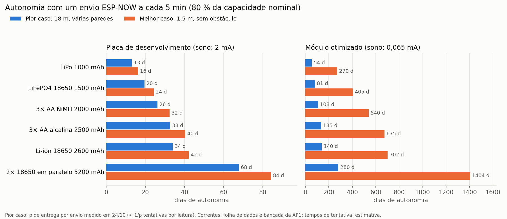

# Bateria de testes ESP-NOW — 24/10/2026

Alcance e desempenho do ESP-NOW entre um nó sensor (ESP32 + DHT22) e um gateway
(ESP32 ligado ao notebook), em ambiente interno, com 7 situações de distância e
obstáculo. Firmware e gravador: `firmware/` e `gravador/` desta branch.

## Como o teste foi feito

- **Sensor:** ESP32 + DHT22, fixo e alimentado pelo USB do desktop. Envia 10
  pacotes/s de 25 bytes em unicast, no canal WiFi 1.
- **Gateway:** ESP32 no notebook, que se deslocava a cada teste. Para cada pacote,
  devolve um ACK de aplicação e imprime uma linha `@PKT` na serial.
- **Duração:** 60 s por situação, um teste por situação, das 09:56 às 10:11.
- **Latência:** RTT/2. O sensor mede a ida e volta e a envia no pacote seguinte;
  os relógios das placas não são sincronizados.

| Situação | Distância | Obstáculos |
|---|---|---|
| 1 | 1,5 m | nenhum declarado |
| 2 | 3 m | nenhum declarado |
| 3 | 5 m | nenhum declarado |
| 4 | 5 m | 2 portas de madeira |
| 5 | 8 m | 1 parede |
| 6 | 11 m | 2 paredes |
| 7 | 18 m | várias paredes |

## Arquivos

```
brutos/                    o que o gravador gerou, sem alteração
  teste_<situação>.log     saída bruta do gateway (procedência)
  teste_<situação>.csv     um pacote por linha, como o gravador interpretou
  resumo_gravador.csv      o resumo original do gravador (ver o alerta abaixo)
analise.py                 reanálise a partir de brutos/ -> resultados_corrigidos.csv
energia.py                 modelo de energia -> energia.csv e vida_util_baterias.png
resultados_corrigidos.csv  os números deste README
```

Para reproduzir: `python analise.py` e depois `python energia.py`, dentro desta pasta.

## Alerta: o resumo do gravador superestimou as perdas

O `resumo_gravador.csv` aponta perdas de 86 % a 3 m, 55 % a 5 m e 51 % a 8 m.
**Essas perdas não aconteceram no rádio.** Em todos esses testes chegaram cerca
de 600 pacotes em 60 s, que é a taxa cheia de 10 por segundo. Os números vieram de dois
defeitos da serial entre o gateway e o notebook:

1. **Linha velha no início do teste.** Entre um teste e outro, a porta continua
   aberta e o buffer acumula linhas. No teste de 5 m, a primeira linha tem
   `seq=4344` e a segunda `seq=5083`: o 4344 é de uns 3 s depois do fim do teste
   anterior. O salto inflou os "esperados" em 739.
2. **Bytes perdidos ou emendados.** No teste de 3 m apareceu `seq=465` entre o
   4164 e o 4166 (faltou o `1` de 4165). O gravador tratou isso como reinício
   do sensor e passou a esperar uns 3.800 pacotes.

O protocolo permite provar que esses pacotes chegaram. Cada pacote leva o
`seq_rtt`, o último ACK que o sensor recebeu. O pacote 4260, por exemplo,
traz `seq_rtt=4259`: o gateway recebeu o 4259 e respondeu, mas a linha dele
saiu estragada na serial. Além disso, o contador de falhas de envio do sensor
(`tx_falhas`) ficou parado em 10 durante todos esses testes.

O `analise.py` refaz as contas com três regras: descarta linhas velhas e
corrompidas, conta como recebido pelo gateway todo `seq` válido ou confirmado
por `seq_rtt`, e confere o resultado contra o `tx_falhas`.

## Resultados corrigidos

| Distância | Obstáculos | Perda (gravador) | Perda de rádio real | Falhas de envio no sensor | Erros só da serial | RSSI médio / p10 (dBm) | Latência mediana / p95 / máx (ms) |
|---|---|---:|---:|---:|---:|---:|---:|
| 1,5 m | nenhum declarado | 0,0 % | **0 de 602 (0,0 %)** | 0 de 601 | 0 | -63,2 / -65 | 1,92 / 4,31 / 7,89 |
| 3 m | nenhum declarado | 86,0 % | **0 de 603 (0,0 %)** | 0 de 602 | 2 | -66,3 / -67 | 1,92 / 4,21 / 7,94 |
| 5 m | nenhum declarado | 55,1 % | **0 de 602 (0,0 %)** | 0 de 601 | 3 | -71,2 / -73 | 1,92 / 4,69 / 10,16 |
| 5 m | 2 portas de madeira | 0,0 % | **0 de 602 (0,0 %)** | 0 de 601 | 0 | -73,8 / -75 | 1,91 / 4,19 / 6,28 |
| 8 m | 1 parede | 51,3 % | **0 de 601 (0,0 %)** | 0 de 600 | 0 | -83,6 / -86 | 2,30 / 4,92 / 14,82 |
| 11 m | 2 paredes | 52,5 % | **112 de 600 (18,7 %)** | 116 de 599 | 0 | -94,3 / -96 | 3,25 / 12,53 / 21,70 |
| 18 m | várias paredes | 98,4 % | **496 de 508 (97,6 %)** | 497 de 507 | 1 | -95,3 / -97 | 4,03 / 13,17 / 13,57 |

| Distância | Obstáculos | Pacotes/s no gateway | Carga útil (B/s) |
|---|---|---:|---:|
| 1,5 m a 8 m | todas as situações | 10,0 | 250 |
| 11 m | 2 paredes | 8,1 | 203 |
| 18 m | várias paredes | 0,2 | 5 |

A perda de rádio corrigida bate com as falhas de envio que o próprio sensor
contou (112 contra 116 a 11 m; 496 contra 497 a 18 m). Os dois números vêm de
caminhos independentes, e a diferença pequena é esperada: uma falha de envio
também pode ser um pacote que chegou mas cujo ACK da camada MAC se perdeu na
volta.

## O que os dados mostram

### Até 8 m com uma parede, o enlace é perfeito
Nenhuma perda de rádio e nenhuma falha de envio em 3.010 pacotes. A latência
mediana ficou em torno de 1,9 ms (RTT de 3,8 ms) em todas essas situações. O
tempo no ar de um pacote de 25 bytes a 1 Mb/s é de cerca de 0,4 ms, então quase
toda essa latência é software: callbacks do WiFi, a fila do FreeRTOS e a troca
de tarefa no gateway. Por isso ela não muda com a distância enquanto o sinal é
bom.

### O RSSI mede o que cada obstáculo custa
- **3 → 5 m, sem obstáculo:** caiu 4,9 dB. Em espaço livre a previsão seria
  20·log(5/3) ≈ 4,4 dB, então o ambiente se comporta quase como espaço aberto.
- **2 portas de madeira (5 m):** só 2,6 dB a mais. Madeira atenua pouco em
  2,4 GHz.
- **1 parede (8 m):** cerca de 10 dB a mais que a 5 m com portas, dos quais uns
  4 dB vêm da distância (20·log(8/5)). A parede de alvenaria custa uns 6 dB.
- **1,5 m:** -63 dBm é fraco para essa distância (o esperado seriam -40 a
  -50 dBm). As antenas de PCB são direcionais, e o notebook e o corpo de quem
  segura atenuam bastante quando ficam perto da antena. A orientação das placas
  pesa tanto quanto a distância em curto alcance.
- **Mínimo de -91 dBm no teste de 5 m sem obstáculo:** foi um desvanecimento
  momentâneo (alguém passando, multipercurso). Ele não causou nenhuma perda e
  não aparece no p10 (-73 dBm).

### A 11 m com duas paredes, o enlace chega ao limite
A sensibilidade do ESP32 a 1 Mb/s é de cerca de -98 dBm (folha de dados). Com
RSSI médio de -94 dBm e p10 de -96 dBm, sobram de 2 a 4 dB de margem, e
qualquer flutuação derruba pacotes: 18,7 % de perda. A cauda da latência
triplica (p95 de 4,7 → 12,5 ms) porque a camada MAC passa a retransmitir. A
fração entregue cai para 8,1 pacotes/s.

### A 18 m com várias paredes, não há enlace útil
Só 2,4 % dos envios chegam. O RSSI médio de -95 dBm é **otimista**: ele só
inclui os 12 pacotes que conseguiram passar. O sinal típico desse ponto está
abaixo da sensibilidade.

### "Taxa de dados" aqui é carga oferecida, não capacidade
O sensor manda 10 pacotes/s fixos. Os 250 B/s medidos até 8 m são exatamente o
que foi enviado. O teste mede a fração entregue, não o máximo que o ESP-NOW
aguenta.

### Limites desta bateria
- Um único teste de 60 s por situação: não dá para medir variação entre dias ou
  horários.
- As paredes não foram caracterizadas (material, espessura), e a orientação das
  placas não foi controlada.
- A situação de 18 m gerou só 13 linhas. As estatísticas de latência e RSSI dela
  valem como indicação, não como medida.

## Adequação ao cenário: vários sensores em ambientes fechados, um gateway

O cenário é o do TermoStats: vários nós medindo temperatura e umidade em salas
controladas (farmácia de manipulação, salas de TI, câmaras frias), enviando a um
gateway central.

**O ESP-NOW serve, com uma regra de instalação.** Os dados sustentam:
- **Confiável:** mesma sala, ou até uma parede de alvenaria a cerca de 8 m.
  Sobram uns 12 dB de margem (p10 de -86 dBm).
- **Marginal:** duas paredes, ou cerca de 11 m. Funciona com retransmissão,
  mas perde quase um quinto dos pacotes e gasta mais energia.
- **Inviável:** três ou mais paredes, ou mais de 15 m.

Como critério de projeto, sugiro **RSSI p10 de pelo menos -85 dBm** em cada
ponto de instalação, medido com este mesmo gravador antes de fixar o nó.

**Muitos nós não sobrecarregam o canal.** Com um envio a cada 5 min, cada nó
ocupa cerca de 1 ms de ar por ciclo. Cem nós somam bem menos de 0,1 % do
canal, e o CSMA/CA do 802.11 resolve as colisões ocasionais. O limite não é
tráfego, é alcance.

**Cuidados de implementação:**
- **Limite de peers:** o ESP-NOW guarda no máximo 20 peers. Para *receber*, o
  gateway não precisa registrar os sensores. O ACK de aplicação deste teste
  registra cada sensor como peer e existe só para medir latência; em produção,
  basta o ACK da própria camada MAC (o callback de envio do sensor).
- **Canal do gateway:** se o gateway também se conectar ao WiFi para subir os
  dados (MQTT, como no Lab 03), o canal passa a ser o do roteador. Os sensores
  precisam usar esse mesmo canal: fixe o canal no roteador ou faça os sensores
  procurarem o gateway.
- **Câmaras frias e freezers não foram testados.** Paredes de painel metálico
  funcionam como gaiola de Faraday e podem atenuar muito mais que alvenaria.
  Antes de instalar, é preciso testar com o nó dentro da câmara. As
  alternativas são uma placa com antena externa (ESP32-WROOM-32U, com a antena
  do lado de fora), um gateway por ambiente, ou um nó repetidor.
- **Margem extra:** o modo Long Range do ESP32 (`WIFI_PROTOCOL_LR`) troca
  taxa por sensibilidade e merece um teste nas situações de 11 e 18 m.

## Energia no pior caso (18 m, várias paredes) com envio a cada 5 minutos

### Modelo
Em cada ciclo o nó acorda do deep sleep, lê o DHT22, tenta enviar até o
gateway confirmar e volta a dormir: 288 ciclos por dia. No pior caso cada
envio é confirmado com probabilidade p = 2,4 % (medido a 18 m). Em média são
necessárias 1/p ≈ 42 tentativas por leitura.

| Parâmetro | Valor | Origem |
|---|---|---|
| Acordado, sem rádio | 46,5 mA durante 0,30 s | corrente: folha de dados (a mesma da AP1); tempo: estimativa |
| Cada tentativa de envio | 240 mA durante 15 ms | corrente: folha de dados, TX 802.11b a +19,5 dBm o tempo todo (pessimista); tempo: estimativa, da ordem do p95 de RTT medido a 11–18 m |
| Tentativas por leitura | 42,3 (pior) e 1 (melhor) | **medido**: 1/p, com p de `resultados_corrigidos.csv` |
| Sono, placa de desenvolvimento | 2,0 mA | bancada (AP1) |
| Sono, módulo otimizado | 0,065 mA | folha de dados: ESP32 10 µA + LDO 5 µA + DHT22 em espera 50 µA |
| Capacidade útil | 80 % da nominal | convenção da AP1 |

### Consumo diário

| Hardware | Caso | Acordado | Rádio | Sono | Total (mA·h/dia) |
|---|---|---:|---:|---:|---:|
| Placa de desenvolvimento | pior (18 m) | 1,12 | 12,19 | 48,00 | **61,31** |
| Placa de desenvolvimento | melhor (1,5 m) | 1,12 | 0,29 | 48,00 | **49,40** |
| Módulo otimizado | pior (18 m) | 1,12 | 12,19 | 1,56 | **14,87** |
| Módulo otimizado | melhor (1,5 m) | 1,12 | 0,29 | 1,56 | **2,96** |

### Vida útil



| Bateria | Placa dev, pior caso | Módulo otimizado, pior caso | Módulo otimizado, melhor caso |
|---|---:|---:|---:|
| LiPo 1000 mAh | 13 dias | 54 dias (~1,8 meses) | 270 dias (~0,7 anos) |
| LiFePO4 18650 1500 mAh | 20 dias | 81 dias (~2,7 meses) | 405 dias (~1,1 anos) |
| 3× AA NiMH 2000 mAh | 26 dias | 108 dias (~3,5 meses) | 540 dias (~1,5 anos) |
| 3× AA alcalina 2500 mAh | 33 dias | 135 dias (~4,4 meses) | 675 dias (~1,8 anos) |
| Li-ion 18650 2600 mAh | 34 dias | 140 dias (~4,6 meses) | 702 dias (~1,9 anos) |
| 2× 18650 em paralelo 5200 mAh | 68 dias | 280 dias (~9,2 meses) | 1.404 dias (~3,8 anos) |

### O que a conta diz
- **Na placa de desenvolvimento, quem dimensiona é o sono.** O regulador e o
  conversor USB-serial acesos gastam 48 de 61 mA·h/dia (78 %) até no pior
  caso. Melhorar o enlace quase não muda nada: são semanas de bateria em
  qualquer cenário.
- **No módulo otimizado, quem dimensiona é o rádio no pior caso.** As 42
  tentativas por leitura são 82 % do consumo. Sair de 18 m com várias paredes
  para um ponto com enlace bom multiplica a autonomia por 5 (Li-ion 18650: de
  4,6 meses para 1,9 ano). **Posicionar bem o gateway rende mais que trocar a
  bateria.**
- **Insistir num enlace ruim é caro e não garante entrega.** Mesmo limitando a
  30 tentativas, a chance de perder a leitura seria (1 - 0,024)³⁰ ≈ 49 %. A 18 m,
  a resposta certa é um repetidor ou um segundo gateway, não mais tentativas.
- **Baterias que ficaram de fora ou que pedem cuidado:**
  - A **CR2032** ficou fora do gráfico: ela não fornece os picos de 240 mA do
    rádio.
  - A **alcalina** tem capacidade nominal medida em corrente baixa e entrega
    menos com picos altos; os números dela são otimistas.
  - A **LiFePO4** (3,2 V) alimenta o ESP32 direto, sem regulador, e combina
    bem com o módulo otimizado.
- **Sensibilidade às estimativas:** a parte do rádio é proporcional ao tempo
  por tentativa. Se forem 30 ms em vez de 15 ms, o pior caso do módulo
  otimizado vai a 27 mA·h/dia (≈ 77 dias com uma 18650). O próximo passo é
  medir esse tempo em bancada.

## Comparação com o BLE (branch `teste-ble`)

O teste equivalente com BLE está na branch `teste-ble`: o BLE não sustenta o
enlace sequer a 13 m com 3 paredes. Os dados desta bateria explicam por quê:

| | ESP-NOW (WiFi 802.11b, 1 Mb/s) | BLE do ESP32 (1M PHY) |
|---|---:|---:|
| Potência máxima de transmissão | +19,5 dBm | +9 dBm |
| Sensibilidade de recepção | ≈ -98 dBm | ≈ -97 dBm |
| Orçamento de enlace | ≈ 117 dB | ≈ 106 dB |

Valores da folha de dados do ESP32. A sensibilidade é parecida; a diferença
está na potência: **o BLE tem cerca de 11 dB a menos de orçamento de enlace.**

- **A 11 m com 2 paredes,** o ESP-NOW já chegava com -94 dBm de média, a 4 dB
  do limite e com 18,7 % de perda. Com 11 dB a menos, o BLE chegaria em torno
  de -105 dBm, 8 dB abaixo da sensibilidade: sem enlace.
- **13 m com 3 paredes é mais difícil que isso.** A distância extra soma cerca
  de 1,5 dB (20·log(13/11)), e a terceira parede uns 6 dB, pela atenuação
  medida acima. O ESP-NOW ficaria perto de -101 dBm, já no limite; o BLE,
  perto de -113 dBm, 16 dB abaixo do que o rádio consegue decodificar.
- **O ESP32 original só tem BLE 4.2 (1M PHY).** O PHY codificado de longo
  alcance do BLE 5 (Coded PHY, até +12 dB de sensibilidade) existe no ESP32-C3
  e no ESP32-S3, não na placa usada aqui.

Para o cenário de vários ambientes com paredes entre o sensor e o gateway, o
BLE do ESP32 fica restrito à mesma sala. O ESP-NOW cobre uma ou duas paredes.

## Próximos passos

1. **Corrigir o gravador:** descartar o buffer de forma confiável no início de
   cada teste (descartar os primeiros 0,5 s), validar cada linha como o
   `analise.py` faz e contar como recebido também o que o `seq_rtt` confirma.
2. Repetir as situações de 8 m e 11 m em dois horários diferentes, para ter
   variação.
3. Testar dentro de uma câmara fria ou freezer, e testar o modo Long Range.
4. Medir em bancada a corrente e o tempo de uma tentativa de envio, para trocar
   as duas estimativas do modelo de energia por medidas.
